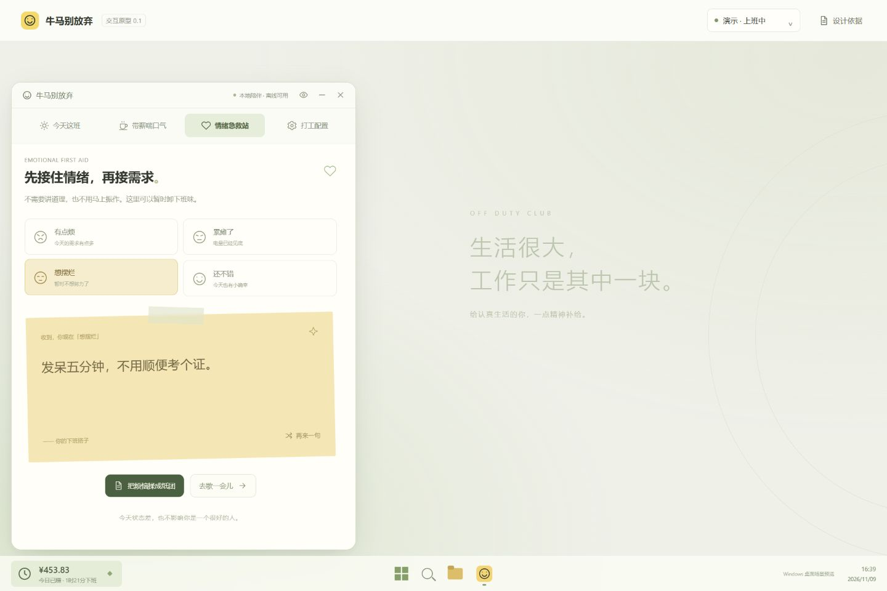

# 牛马不放器

给打工人的一点精神补给：看一眼估算收益和下班时间，吐槽两句，或者把烦恼揉成纸团。

牛马不放器是面向 Windows 的本地桌面工具。收益和状态信息显示在任务栏内的一个入口中：点击打开新版面板，再点击同一入口收起。面板自身不增加普通任务栏按钮；系统托盘保留恢复与退出入口。界面使用 HTML/CSS/JavaScript，宿主使用 .NET 10、WPF、WinForms 和 WebView2。

当前为 **0.1.3 开发预览版**。本版改为任务栏内入口，不再创建工作区底部的绿色悬浮卡片。新的任务栏模式仍待人工验收，具体构建与实测结果以 [验证记录](docs/verification.md) 为准。仓库保留独立的浏览器交互演示。

[GitHub 仓库](https://github.com/Humboldt-Zh/niuma-bufangqi) · [构建与测试](https://github.com/Humboldt-Zh/niuma-bufangqi/actions) · [发布页](https://github.com/Humboldt-Zh/niuma-bufangqi/releases)



截图来自此前的浏览器演示，只用于说明面板内容，不能证明 0.1.3 的原生任务栏模式已通过实测。

## 功能

- **今天这班**：按自定义月薪、计薪天数和排班估算当日收益，显示下班倒计时与计薪进度。
- **带薪喘口气**：主动开始 3 / 5 / 10 分钟休息，到点轻提示，由自己决定何时结束；查看和清除本地休息记录。
- **情绪急救站**：选择“有点烦、累瘫了、想摆烂、还不错”，收下一句回应，也可以换一句。
- **烦恼回收站**：写字、选预设或留空，点按揉纸后拖进纸篓；也可使用按钮和键盘操作。完成后可再来一张、开始休息或返回。
- **任务栏陪伴**：真实系统时间、任务栏内的收益入口、点击开关面板、系统托盘、金额隐藏和用户主动开启的开机启动。

首次未配置时没有虚构工资，会自动进入设置；已配置用户启动后只显示任务栏入口，点击后再展开面板，也可用 `--open` 明确打开。保存经原生校验并确认成功后才生效。任务栏入口以子窗口附着到 Explorer 的主任务栏，使用其内部布局信息定位；Windows 更新可能影响兼容性。无法确认安全空位时只保留托盘入口，不回退为绿色浮窗。

## 运行 Windows 软件

首版面向 Windows 11 x64。需要 **Microsoft Edge WebView2 Evergreen Runtime**；程序会检测缺失情况并引导到 [Microsoft 官方下载页](https://developer.microsoft.com/microsoft-edge/webview2/#download-section)。Windows 11 通常已包含该运行时，仍需以本机检测结果为准。

解压明确标记为 0.1.3 的 win-x64 ZIP，在固定目录运行其中的 `NiumaBufangqi.exe`。发布目录包含自带的 .NET 运行时，无需另外安装 .NET；WebView2 Runtime 是单独的前置依赖。

升级前请从退出菜单彻底结束旧薪资时钟和 0.1.0 绿色浮窗版。0.1.3 检测到旧 `SalaryClock` 进程，或同一配置正在被其他目录中的牛马不放器使用时，会提示先退出旧版本，不叠加新入口，也不激活另一目录中的旧界面。它不会自动结束其他程序、替换旧入口或接管启动项；已经运行的两个旧版本仍需用户各自退出。已有 `%LOCALAPPDATA%\NiumaBufangqi\state.json` 中的设置继续使用，无需重填。完整步骤见 [手动升级与验收](docs/manual-upgrade.md)。

再次点击任务栏入口、面板关闭按钮或普通页面的 `Esc` 都可收起面板。要彻底结束程序，使用任务栏入口右键菜单或系统托盘中的“退出”。开机启动开关反映当前 EXE 的实际启动项；换到新目录后未勾选属于正常情况，是否开启由用户决定。开启后只写当前 Windows 用户的启动项，无需管理员权限。升级后的快捷方式和自启动目标由用户主动确认；移动程序前先关闭旧启动项。

本地预览产物尚未进行代码签名。SHA-256 校验文件用于核对发布文件完整性，不替代发布者身份验证。

## 从源码构建

准备 Windows、.NET SDK **10.0.403** 和 Node.js **24**。`global.json` 固定 SDK 功能带并允许较新的补丁版本；Node.js 用于检查和测试网页部分。

在 PowerShell 中运行：

```powershell
.\scripts\build.ps1
```

也可以分别运行检查：

```powershell
dotnet restore NiumaBufangqi.sln
dotnet build NiumaBufangqi.sln -c Release --no-restore
dotnet run --project tests/NiumaBufangqi.Core.Tests -c Release
dotnet run --project tests/NiumaBufangqi.Taskbar.Tests -c Release
npm run check
npm test
```

Core 与任务栏几何测试是无第三方测试包的控制台程序，失败会以非零状态退出；不能用 `dotnet test` 替代这些入口。几何测试只运行纯计算，不创建窗口或查询真实任务栏。网页部分没有需要安装的 npm 依赖。

生成自包含的 x64 发布包：

```powershell
.\scripts\publish.ps1
```

产物写入 `artifacts/`，包含可运行目录、ZIP 和 SHA-256 校验文件，具体文件名以脚本输出为准。发布时必须保留许可证、第三方声明和运行依赖。

普通构建和 x64 发布分别锁定依赖，版本以 `Directory.Build.props` 为准并核对 `package.json`。草稿发布工作流要求版本标签已指向本次提交。首版原生人工验收尚未全部完成，发布草稿供维护者验收后公开。

## 浏览器交互演示

使用现代浏览器打开 `index.html`，或运行：

```powershell
npm start
```

访问终端显示的本机地址，默认端口 4173。无需 `npm install`。该演示使用虚构工资和示例日期，可切换场景；浏览器数据与原生软件的数据独立。原生程序直接加载打包的本地资源，不需要这个 HTTP 服务。

## 计薪口径

```text
参考日薪 = 月薪 ÷ 月计薪天数
净计薪时长 = 下班时间 − 上班时间 − 已启用的午休时长
今日已赚 = 参考日薪 × 已过计薪时长 ÷ 净计薪时长
```

午休扣除开启时收益暂停，下班后封顶，休息日归零。距下班按时钟时间倒数，计薪进度按净计薪时长计算。休息期间展示的估算金额已经包含在今日收益中，不能再次相加。

金额不代表实发或真实到账。当前不处理税费、社保、奖金、请假、节假日调休、加班费及跨夜班；月计薪天数是用户自填折算参数。

## 本地数据与隐私

原生软件的状态保存在 `%LOCALAPPDATA%\NiumaBufangqi\state.json`，包括排班、金额隐藏、自启动偏好和休息记录；WebView2 的本地用户数据位于同目录的 `WebView2` 子目录。状态带版本号，采用原子写入和备份恢复；遇到更新版本的配置会拒绝覆盖。

配置以本地 JSON 保存，未进行应用级加密。不要将个人配置、备份或 WebView2 用户目录提交到仓库。浏览器演示使用自己的 `localStorage`，不自动读取原生配置。

烦恼文字仅在当前交互内存中存在，完成或关闭时清空，不加入历史。软件不接入账户、云同步、分析埋点或 AI 服务，不上传工资和烦恼。应用界面使用打包资源；下载依赖、点击外链以及 WebView2 Evergreen 自身的更新可能联网。

## 参与项目

欢迎贡献可复现问题、测试、文案及无障碍改进。先阅读 [贡献指南](CONTRIBUTING.md)、[安全说明](SECURITY.md) 和 [架构说明](docs/architecture.md)。

[ADR 0001](docs/adr/0001-windows-host.md) 记录宿主技术选择；[ADR 0002](docs/adr/0002-taskbar-entry.md) 按用户明确要求，将入口改为任务栏内子窗口，并取代原工作区浮窗选择。[调研记录](docs/research.md) 和 [话术改写记录](docs/report-copy-adaptation.md) 区分参考资料、原创改写与待验证假设；没有把公开资料调研当作效果验证。

## 许可证

本项目原创代码、图形和文案使用 [MIT License](LICENSE)。依赖及运行时保留各自许可，详见 [第三方声明](THIRD_PARTY_NOTICES.md)。
